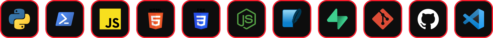

<div align="center">



<br/>

<a href="https://www.linkedin.com/in/gabriel-rodrigues-53a124269" target="_blank"></a>
<a href="mailto:gp776945@gmail.com"></a>


</div>

<br/>

## 👨‍💻 Sobre mim

Comecei em **Recrutamento & Seleção** e hoje atuo com **BI e Automação com IA** no **Grupo Pro Security**. Vivi na pele o que hoje resolvo com código: controles em planilha, dados sem validação e relatórios montados à mão.

Por isso meu ponto de partida é sempre o **processo**, não a ferramenta: entender onde o tempo se perde, medir e entregar algo que a equipe usa no dia seguinte.

<div align="center">
  
</div>

<details>
<summary><b>🐍 Eu, em Python</b> <i>(clique para abrir)</i></summary>

<br/>

```python
class Gabriel:
    cargo     = "BI e Automação com IA"
    empresa   = "Grupo Pro Security"
    estudando = "Análise e Desenvolvimento de Sistemas"
    stack     = ["Python", "PowerShell", "JavaScript", "HTML/CSS", "SQLite", "Excel"]
    foco      = ["dashboards executivos", "automação de rotinas", "IA aplicada ao RH"]

    def resolver(self, processo_manual):
        dados = validar(processo_manual)      # primeiro, confiar no número
        rotina = automatizar(dados)           # depois, tirar o trabalho repetitivo
        return dashboard(rotina)              # por fim, virar decisão


if __name__ == "__main__":
    print(Gabriel().resolver("planilha de sexta-feira às 18h"))
    # >>> tempo devolvido para o time
```

</details>

## 🚀 O que eu construo

<table>
  <tr>
    <td width="50%" valign="top">
      <h3>📊 Dashboards executivos</h3>
      Indicadores de R&amp;S e RH — SLA de vagas, admissões, turnover — em HTML de um arquivo, leve e pronto para a liderança decidir.
    </td>
    <td width="50%" valign="top">
      <h3>⚙️ Automação de rotinas</h3>
      Scripts em Python e PowerShell que consolidam bases, validam dados e eliminam etapas manuais repetidas toda semana.
    </td>
  </tr>
  <tr>
    <td width="50%" valign="top">
      <h3>🌐 Ferramentas web</h3>
      Portais e páginas internas em HTML, CSS e JavaScript, pensados para quem usa — não para quem desenvolve.
    </td>
    <td width="50%" valign="top">
      <h3>🤖 IA aplicada ao trabalho</h3>
      Claude Code e agentes de IA para acelerar desenvolvimento, análise de dados e documentação.
    </td>
  </tr>
</table>

## 🛠️ Stack

<div align="center">



<br/><br/>


</div>

## 📂 Projetos

| Projeto | O que é | Stack |
|---|---|---|
| [**Roteiro de Entrevista Automatizado**](https://github.com/gabriel-rodrigues0/ROTEIRO-DE-ENTREVISTA-AUTOMATIZADO) | Roteiro de entrevista de R&S que roda direto no navegador |  |
| [**GEOTEC**](https://github.com/gabriel-rodrigues0/GEOTEC) | Site de geografia feito no 2º ano do técnico (2023) |  |
| [**To-do App**](https://github.com/gabriel-rodrigues0/todo-app) | Lista de tarefas |  |
| [**Geladinho Vendas**](https://github.com/gabriel-rodrigues0/geladinho-vendas) | Controle de vendas |  |

<details>
<summary><b>🎓 Mais projetos do curso técnico</b></summary>

<br/>

[Calendário da Copa](https://github.com/gabriel-rodrigues0/calendario-copa) · [NFT Card](https://github.com/gabriel-rodrigues0/nft-card) · [Carros](https://github.com/gabriel-rodrigues0/Carros) · [Node + Express](https://github.com/gabriel-rodrigues0/node_express) · [Trabalho de Python](https://github.com/gabriel-rodrigues0/Trabalho-python)

</details>

## 📈 No GitHub

<div align="center">


<br/><br/>

<picture>
  <source media="(prefers-color-scheme: dark)" srcset="https://raw.githubusercontent.com/gabriel-rodrigues0/gabriel-rodrigues0/output/github-snake-dark.svg" />
  
</picture>

</div>

<details>
<summary><b>💬 Perguntas rápidas</b></summary>

<br/>

**Por que BI dentro do RH?**
Porque atraso em R&S vira posto descoberto no cliente. Quem vê o número a tempo consegue agir antes.

**O que você está estudando agora?**
Análise e Desenvolvimento de Sistemas, agentes de IA e automação de ponta a ponta.

**Topa trocar ideia?**
Sempre — sobre dados, automação ou IA no RH. Me chama no LinkedIn.

</details>

<br/>

<div align="center">
  <sub>Feito com café, planilhas e um pouco de Python ☕</sub>
</div>
